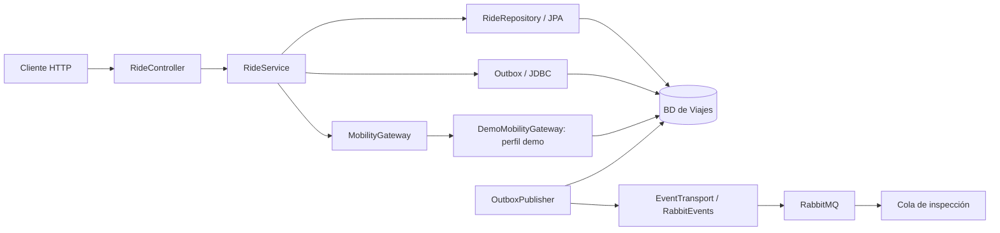

# Arquitectura de la demo de Viajes

Estado revisado: 2026-10-31. Alcance: primera iteración del servicio Viajes (`rides`).

## Componentes y responsabilidades

La demo de Viajes expone una API HTTP con Java 21 y Spring Boot, persiste viajes y eventos pendientes, calcula el coste preliminar y publica cambios por RabbitMQ cuando se habilita el transporte. La página estática de bienvenida no es una aplicación cliente completa.

`RideController` valida la entrada; `RideService` coordina las transacciones y reglas; `RideRepository` usa JPA para los viajes; `Outbox` y el adaptador demo usan JDBC. El puerto `MobilityGateway` delimita las dependencias de movilidad. Esto aporta un punto de sustitución, pero no implica una separación hexagonal completa: el servicio de aplicación depende directamente de Spring, persistencia y métricas.

El código Java se organiza por responsabilidad bajo `com.urbanmove.rides`: `controller`, `dto`, `service`, `model`, `repository`, `exception`, `integration` (con `demo`), `messaging` (con `outbox`) y `observability`. `RidesApplication` permanece en la raíz para conservar el escaneo de Spring Boot. La entidad mantiene sus campos privados y expone métodos de inicio/finalización y lectura. Véase [ADR-0007](../../../docs/adr/0007-organizacion-paquetes.md) y la [distribución de clases](../README.md#estructura-del-código).

## Propiedad de datos y entornos

| Elemento | Estado y responsabilidad |
| --- | --- |
| `rides` | Estado del viaje, claves de idempotencia y copia de la tarifa |
| `outbox_events` | Eventos pendientes/publicados y datos de reintento |
| `demo_vehicles`, `demo_reservations`, `demo_zones` | Simulación local; no son bases compartidas de otros servicios |
| H2 persistente | Ejecución local predeterminada, eventos sin publicar por defecto |
| PostgreSQL y RabbitMQ | Entorno Compose; perfil demo y publicación habilitados |
| Flyway | Versionado del esquema; Hibernate valida el esquema |

Disponibilidad, Reservas, Zonas, Identidad, Historial, notificaciones e ingesta analítica no están integrados en esta demo. El repositorio también contiene el servicio de Reservas y la infraestructura común de develop. Los consumidores de eventos son previstos; la única cola declarada por el servicio es la de inspección. Las bases de los futuros servicios no deben acceder directamente a estas tablas.

## Flujos y garantías actuales

1. **Inicio:** buscar la clave de idempotencia, reclamar el vehículo mediante el adaptador demo, copiar origen/tipo/tarifa, guardar `IN_PROGRESS` y añadir `RideStarted` en una transacción local.
2. **Consulta:** recuperar un viaje por UUID. No hay listado global ni historial proyectado.
3. **Finalización:** bloquear el viaje, validar destino y liberar el vehículo demo, calcular duración/coste, guardar `FINISHED` y añadir `RideFinished` en la misma transacción.
4. **Publicación:** bloquear un evento pendiente, enviarlo y marcarlo publicado tras confirmación y comprobación de devolución. Los fallos persisten con espera exponencial de hasta 60 segundos.

Las restricciones únicas impiden dos viajes activos por usuario o vehículo dentro de esta BD. Los POST utilizan claves de idempotencia persistidas; un reintento puede devolver el estado actual del viaje, y los conflictos concurrentes pueden requerir reintento. El precio se conserva por viaje; no se realizan cobros.

La entrega de eventos es al menos una vez, con posibles duplicados y sin orden global garantizado. Cada consumidor debe tener su propia cola y deduplicar por `eventId`. La outbox publica como máximo un evento por tick y mantiene una transacción/bloqueo mientras espera al transporte.

Las decisiones y sus costes se detallan en el [registro ADR](../../../docs/adr/README.md).

## Observabilidad y verificación existente

Hay logs JSON con correlación, endpoints Actuator y métricas Prometheus de viajes y outbox. Compose usa liveness para el contenedor de Viajes; una caída del broker puede degradar el health global sin impedir las operaciones locales.

Las pruebas de integración cubren ciclo de viaje, idempotencia, restricciones concurrentes, reservas, tarifas, rollback y recuperación de publicación con transporte simulado. La prueba de RabbitMQ real es condicional a `RUN_RABBIT_TESTS=true`. El [workflow](../../../.github/workflows/rides.yml) configura verificaciones con H2, PostgreSQL, RabbitMQ, Compose y construcción de imagen. Véanse instrucciones y variables en el [README del servicio](../README.md).

## Pendientes antes de una integración real

| Pendiente | Motivo / siguiente decisión |
| --- | --- |
| Claims y liberaciones remotos | Acordar contratos, idempotencia por `rideId`, responsabilidades y recuperación; [ADR-0006](../../../docs/adr/0006-integracion-remota-coordinada.md) es una propuesta |
| Autenticación y autorización | Resolver identidad del token y propiedad del viaje; actualmente se acepta `userId` del cliente |
| Consumo de reservas y disponibilidad | Acordar quién actualiza cada estado y cómo evita dobles efectos por eventos repetidos |
| Evolución de contratos | Acordar compatibilidad y migración de consumidores; hoy los eventos llevan `schemaVersion: 1` |
| Escala y operación de outbox | Definir lotes/particiones, retención, alertas y tratamiento de fallos persistentes; no hay DLQ automática |
| Despliegue fuera de la demo | Definir infraestructura, secretos y controles de acceso; Compose es local |

Estos pendientes no son funcionalidades ni decisiones aceptadas. Deben resolverse y documentarse conforme se aborden, sin asumir que una transacción local abarca servicios remotos.
